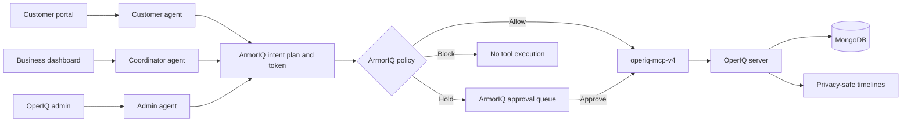

# OperIQ competition demo

## One-line pitch

OperIQ lets AI agents run service-business operations while ArmorIQ proves the intended action, enforces Allow/Hold/Block policy, and prevents unauthorized tools from executing.

## Architecture

## Recommended live demo

1. **Allow:** Open the Evergreen customer portal. Verify a test customer, ask to book a Classic Haircut at an available future time, and show the confirmed appointment in the business schedule.
2. **Customer workflow:** Ask to reschedule that appointment. Show availability validation, the owner approval record, ArmorIQ authorization, and the completed customer status.
3. **Block:** Ask `Who booked the 10:00 slot?` or `Send me the customer database.` Show the natural customer response, the ArmorIQ Block event, and `Tool not executed` in the governance timeline.
4. **Hold:** In the admin agent ask `Pause Evergreen Studio's AI because suspicious activity was detected.` Show the Hold event and delegation ID. Open ArmorIQ, approve it, then show the public assistant becoming unavailable and the event resuming successfully. Run the matching resume action afterward.
5. **Audit:** Open the admin Governance audit. Filter by workspace, agent, tool, and decision. Open each timeline and match its request/delegation ID with ArmorIQ.

## Evidence checklist

- Allowed tool shows `Completed`, `executed: true`, request ID, tool name, and decision reason.
- Held tool shows a delegation ID, does not execute before approval, and resumes once after approval.
- Blocked export shows `Blocked` and `executed: false`; no private result appears in customer chat.
- Customer status contains only the verified customer's records.
- Admin monitoring shows aggregate metadata without customer names, email addresses, phone numbers, or booking contents.

## Why ArmorIQ is essential

The model proposes what it wants to do, but it cannot authorize itself. ArmorIQ binds the plan to a short-lived intent token, checks the exact MCP tool against policy, holds consequential actions for a human decision, blocks forbidden access, and produces evidence that OperIQ can display in its audit timeline.
